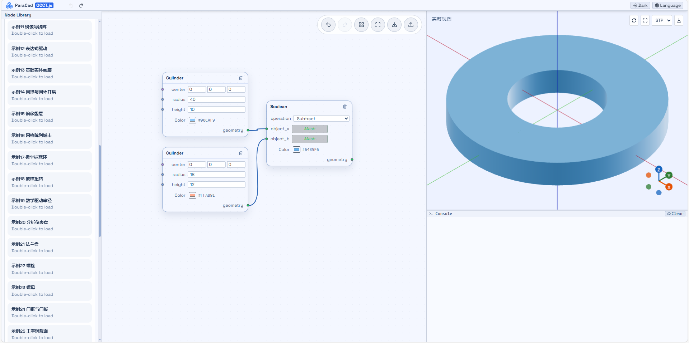

<h1 align="center">ParaCad</h1>

<p align="center">A browser-based, node-driven parametric 3D modeling workbench built with React, TypeScript, and Three.js.</p>

<p align="center">
  <a href="./README.md">English</a> | <a href="./README.zh-CN.md">简体中文</a>
</p>

<p align="center">
     <a href="./docs/architecture.md"></a> <a href="./LICENSE"></a>
</p>

ParaCad combines a visual node graph editor with a real-time Three.js viewport so you can build, inspect, and iterate on parametric 3D geometry directly in the browser without installing desktop CAD software.

## Highlights

| Highlight | Why it matters |
|---|---|
| Visual node graph workflow | Wire parameters, 2D sketches, 3D solid primitives, booleans, transforms, arrays, and measurement nodes on an interactive canvas with `dagre` auto-layout. |
| Multi-pass cached graph solver | Propagates expression dependencies across nodes (including math helpers and ternary expressions) while skipping unchanged nodes via input-hash caching. |
| Real-time Three.js viewport | Renders computed meshes in an orthographic 3D canvas with orbit, pan, zoom, axis gizmo, fit-to-view, and automatic upstream preview hiding. |
| Built-in presets and bilingual UI | Ships with ready-to-load `Flange` and `Valve` graph presets, English/Chinese UI switching, and light/dark themes. |
| Browser-side mesh export | Exports visible computed geometry directly from the browser to `GLB` or `OBJ`. |

## Architecture

ParaCad follows a three-layer architecture documented in [docs/architecture.md](./docs/architecture.md):

```text
┌──────────────────────────────────────────────────────────────────────┐
│                   View & Interaction Layer (components/)             │
│  ┌──────────────────┐   ┌──────────────────┐   ┌──────────────────┐  │
│  │    NodeTree      │   │    NodeCanvas    │   │ Viewer3D + Log   │  │
│  │ (Library/Presets)│   │ (Graph Editor)   │   │ (Three.js View)  │  │
│  └────────┬─────────┘   └────────┬─────────┘   └────────▲─────────┘  │
└───────────┼──────────────────────┼──────────────────────┼────────────┘
            │                      │ edit / trigger       │ render
            ▼                      ▼                      │
┌──────────────────────────────────────────────────────────────────────┐
│            State & Graph Scheduling Layer (store/, core/)            │
│  ┌──────────────────┐   ┌──────────────────┐   ┌──────────────────┐  │
│  │   GraphStore     │──▶│   computeGraph   │──▶│   nodeExecutor   │  │
│  │ (State/History)  │   │ (Solver / Cache) │   │ (Node Handlers)  │  │
│  └──────────────────┘   └──────────────────┘   └────────┬─────────┘  │
└─────────────────────────────────────────────────────────┼────────────┘
                                                          │ meshes
                                                          ▼
┌──────────────────────────────────────────────────────────────────────┐
│              Runtime Kernel & Export Layer (core/kernel/, utils/)    │
│  ┌──────────────────────────────┐   ┌─────────────────────────────┐  │
│  │ Three.js Runtime & CSG       │   │ modelExport (GLB / OBJ)     │  │
│  └──────────────────────────────┘   └─────────────────────────────┘  │
└──────────────────────────────────────────────────────────────────────┘
```

## Usage Example

The workbench pairs the left node library and preset list, the center node canvas, and the right 3D viewport with an execution console. In the example below, two `Cylinder` nodes (radius `40` and radius `18`) feed into a `Boolean` (`Subtract`) node to produce a hollow ring mesh in real time.



> Note: The screenshot above was captured from an earlier UI revision; the current runtime uses Three.js with `GLB` / `OBJ` export and ships with the `Flange` (`public/examples/01-flange.json`) and `Valve` (`public/examples/02-valve.json`) presets.

## Quick Install

Prerequisites:

- Node.js 20 or later (matching `.github/workflows/deploy-pages.yml`)
- npm

Clone the repository and install dependencies:

```bash
git clone https://github.com/zly258/paracad.git
cd paracad
npm install
```

## Quick Start

1. Start the Vite development server:

```bash
npm run dev
```

2. Open `http://localhost:3000` in a modern browser.
3. In the left **Node Library** panel, double-click a built-in example preset (`Flange` or `Valve`) or drag nodes onto the canvas and connect their sockets.
4. Adjust parameters in the node cards to watch the 3D viewport update in real time.
5. Export the computed geometry as `GLB` or `OBJ` when ready.

## Commands

| Command | Description |
|---|---|
| `npm run dev` | Start the local Vite development server on port `3000`. |
| `npm run build` | Build the production bundle into `dist/` (configured with base path `/paracad/`). |
| `npm run preview` | Preview the built `dist/` bundle locally. |

## Node Library

The built-in node library (`core/nodes/library.ts`) is organized into seven categories:

| Category | Nodes |
|---|---|
| Core | `Parameter`, `Expression` |
| Sketch 2D | `Line`, `Rectangle`, `Circle`, `Arc`, `Ellipse`, `Polygon`, `Star` |
| Solid Primitives | `Box`, `Sphere`, `Cylinder`, `Cone`, `Frustum`, `Torus`, `Ellipsoid`, `Capsule` |
| Solid Operations | `Extrude`, `Revolve`, `Sweep`, `Loft`, `Boolean`, `Fillet` |
| Transform & Array | `Move`, `Rotate`, `Scale`, `Mirror`, `Array Linear`, `Array Grid`, `Array Polar` |
| Measure | `Bounding Box`, `Surface Area`, `Volume`, `Centroid` |
| Data & Math | `Number Range`, `Range By Count`, `List Create`, `List Length`, `List Get Item`, `Vector Create` |

## Documentation

| Topic | What it covers | Link |
|---|---|---|
| Architecture | Three-layer design and Three.js runtime overview | [docs/architecture.md](./docs/architecture.md) |
| Roadmap & priorities | Ongoing stability, boolean, and viewport goals | [docs/plan.md](./docs/plan.md) |
| Commit conventions | Commit message format (`type(scope): summary`) | [docs/git-commit.md](./docs/git-commit.md) |

## Contributing

Contributions are welcome. Follow the commit format in [docs/git-commit.md](./docs/git-commit.md) (`type(scope): summary`) and verify that `npm run build` completes cleanly before opening a pull request.

## License

This project is licensed under a modified MIT License for personal, educational, or non-commercial use only; commercial use requires prior written permission from the copyright holder, and redistributions or modifications must attribute the original source and author. See [LICENSE](./LICENSE) for the full terms.
