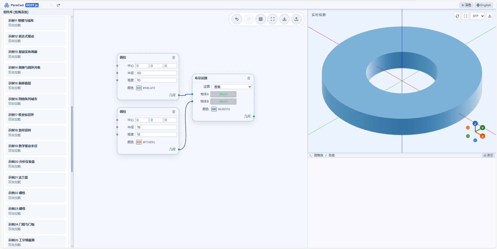

<h1 align="center">ParaCad</h1>

<p align="center">基于 React、TypeScript 与 Three.js 构建的浏览器端节点式参数化三维建模工作台。</p>

<p align="center">
  <a href="./README.md">English</a> | <a href="./README.zh-CN.md">简体中文</a>
</p>

<p align="center">
     <a href="./docs/architecture.md"></a> <a href="./LICENSE"></a>
</p>

ParaCad 将可视化节点图编辑器与实时 Three.js 三维视口结合在一起，无需安装桌面端 CAD 软件，即可在浏览器中直接搭建、预览并迭代参数化三维模型。

## 核心亮点

| 亮点 | 带来的价值 |
|---|---|
| 可视化节点流建模 | 在交互式画布上连接参数、二维草图、三维基础实体、布尔运算、变换阵列与测量节点，并支持基于 `dagre` 的自动布局。 |
| 多轮缓存图求解器 | 支持跨节点表达式依赖传播（包含常用数学函数与三目运算），并通过输入哈希缓存跳过未变更节点的重复计算。 |
| 实时 Three.js 视口 | 提供正交投影三维预览、旋转/平移/缩放、坐标轴指示器、一键充满视图，以及下游节点消费后自动隐藏上游几何预览。 |
| 内置示例与双语界面 | 内置 `法兰`（Flange）与 `阀门`（Valve）示例预设，支持中英文界面切换与浅色/深色主题切换。 |
| 浏览器端模型导出 | 支持将当前可见计算结果直接导出为 `GLB` 或 `OBJ` 格式。 |

## 架构设计

ParaCad 采用三层架构设计，详见 [docs/architecture.md](./docs/architecture.md)：

```text
┌──────────────────────────────────────────────────────────────────────┐
│                   View & Interaction Layer (components/)             │
│  ┌──────────────────┐   ┌──────────────────┐   ┌──────────────────┐  │
│  │    NodeTree      │   │    NodeCanvas    │   │ Viewer3D + Log   │  │
│  │ (Library/Presets)│   │ (Graph Editor)   │   │ (Three.js View)  │  │
│  └────────┬─────────┘   └────────┬─────────┘   └────────▲─────────┘  │
└───────────┼──────────────────────┼──────────────────────┼────────────┘
            │                      │ edit / trigger       │ render
            ▼                      ▼                      │
┌──────────────────────────────────────────────────────────────────────┐
│            State & Graph Scheduling Layer (store/, core/)            │
│  ┌──────────────────┐   ┌──────────────────┐   ┌──────────────────┐  │
│  │   GraphStore     │──▶│   computeGraph   │──▶│   nodeExecutor   │  │
│  │ (State/History)  │   │ (Solver / Cache) │   │ (Node Handlers)  │  │
│  └──────────────────┘   └──────────────────┘   └────────┬─────────┘  │
└─────────────────────────────────────────────────────────┼────────────┘
                                                          │ meshes
                                                          ▼
┌──────────────────────────────────────────────────────────────────────┐
│              Runtime Kernel & Export Layer (core/kernel/, utils/)    │
│  ┌──────────────────────────────┐   ┌─────────────────────────────┐  │
│  │ Three.js Runtime & CSG       │   │ modelExport (GLB / OBJ)     │  │
│  └──────────────────────────────┘   └─────────────────────────────┘  │
└──────────────────────────────────────────────────────────────────────┘
```

## 使用示例

工作台由左侧节点库与示例列表、中间节点画布、右侧三维视口及底部日志控制台组成。下图演示了将两个 `圆柱`（半径分别为 `40` 和 `18`）节点接入 `布尔运算`（差集）节点后，在右侧视口实时生成圆环实体的效果。



> 说明：上述截图取自早期界面版本；当前版本统一使用 Three.js 运行时，支持 `GLB` / `OBJ` 导出，并内置 `法兰`（`public/examples/01-flange.json`）与 `阀门`（`public/examples/02-valve.json`）两个示例预设。

## 快速安装

环境要求：

- Node.js 20 及以上版本（与 `.github/workflows/deploy-pages.yml` 一致）
- npm

克隆仓库并安装依赖：

```bash
git clone https://github.com/zly258/paracad.git
cd paracad
npm install
```

## 快速开始

1. 启动 Vite 开发服务器：

```bash
npm run dev
```

2. 在现代浏览器中访问 `http://localhost:3000`。
3. 在左侧节点库中双击加载内置示例预设（`法兰` 或 `阀门`），或拖入节点并连接端口。
4. 修改节点参数卡片中的数值，即可在右侧三维视口实时查看模型更新。
5. 建模完成后，可将当前计算结果导出为 `GLB` 或 `OBJ` 文件。

## 常用命令

| 命令 | 说明 |
|---|---|
| `npm run dev` | 在 `3000` 端口启动本地 Vite 开发服务器。 |
| `npm run build` | 构建生产包到 `dist/` 目录（生产环境基础路径为 `/paracad/`）。 |
| `npm run preview` | 在本地预览 `dist/` 生产构建结果。 |

## 节点库

内置节点库（`core/nodes/library.ts`）包含七大类别：

| 类别 | 包含节点 |
|---|---|
| Core（核心） | `Parameter`、`Expression` |
| Sketch 2D（二维草图） | `Line`、`Rectangle`、`Circle`、`Arc`、`Ellipse`、`Polygon`、`Star` |
| Solid Primitives（基础实体） | `Box`、`Sphere`、`Cylinder`、`Cone`、`Frustum`、`Torus`、`Ellipsoid`、`Capsule` |
| Solid Operations（实体运算） | `Extrude`、`Revolve`、`Sweep`、`Loft`、`Boolean`、`Fillet` |
| Transform & Array（变换与阵列） | `Move`、`Rotate`、`Scale`、`Mirror`、`Array Linear`、`Array Grid`、`Array Polar` |
| Measure（测量分析） | `Bounding Box`、`Surface Area`、`Volume`、`Centroid` |
| Data & Math（数据与数学） | `Number Range`、`Range By Count`、`List Create`、`List Length`、`List Get Item`、`Vector Create` |

## 文档导航

| 主题 | 内容说明 | 链接 |
|---|---|---|
| 架构说明 | 三层架构设计与 Three.js 运行时概览 | [docs/architecture.md](./docs/architecture.md) |
| 演进计划 | 求解器稳定性、布尔运算与视口优化重点 | [docs/plan.md](./docs/plan.md) |
| 提交规范 | Git 提交信息格式（`type(scope): summary`） | [docs/git-commit.md](./docs/git-commit.md) |

## 参与贡献

欢迎提交改进建议与 Pull Request。提交前请遵循 [docs/git-commit.md](./docs/git-commit.md) 中的提交格式（`type(scope): summary`），并确认 `npm run build` 能够正常通过。

## 许可证

本项目采用附带非商业使用限制的 MIT 许可证，仅限个人、教育或非商业用途；商业使用须事先获得版权方书面许可，再分发或修改须明确标注原始来源与作者。完整条款请参阅 [LICENSE](./LICENSE)。
